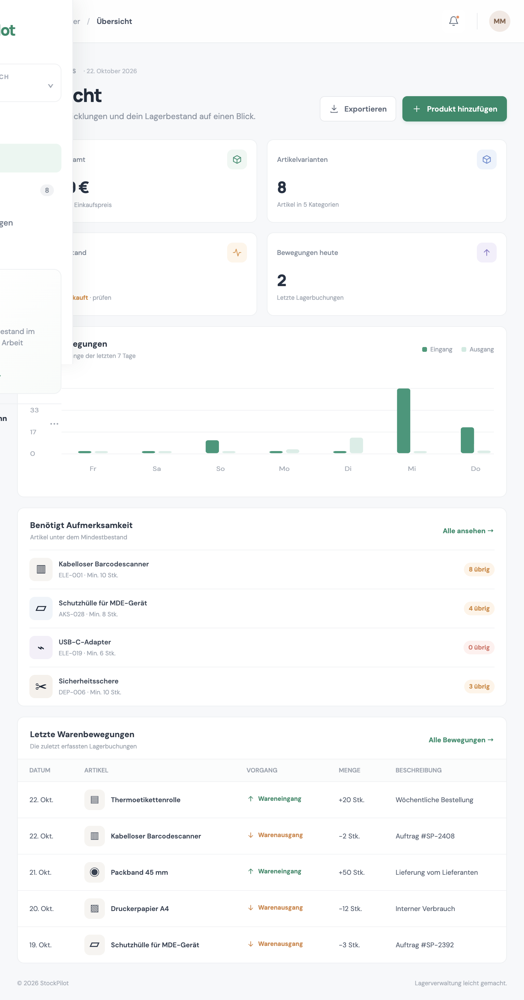
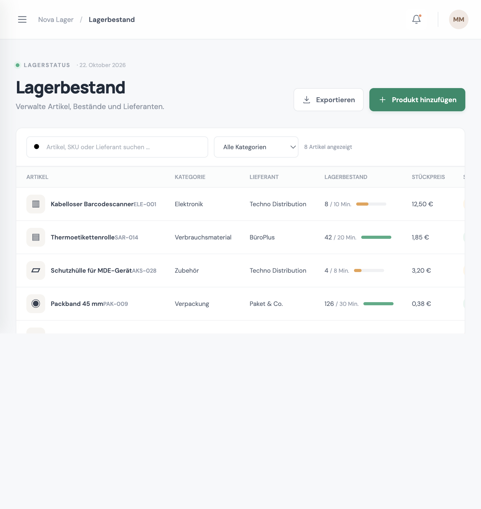

# StockPilot

StockPilot ist eine deutschsprachige Lagerverwaltungs-App für kleine Unternehmen. Sie bündelt Artikel, Lagerbewegungen und Lieferanten in einer übersichtlichen Oberfläche. Das Projekt basiert auf JavaScript, HTML und CSS und lässt sich ohne zusätzliche Abhängigkeiten starten.

## Funktionen

- Dashboard mit Lagerwert, Artikelanzahl, kritischen Beständen und heutigen Bewegungen
- Artikel anlegen, bearbeiten und löschen; Artikelnummern und Mindestbestände verwalten
- Artikel nach Name, SKU, Kategorie oder Lieferant suchen und filtern
- Wareneingänge und -ausgänge erfassen; Ausbuchungen über dem verfügbaren Bestand werden verhindert
- Lieferantenverzeichnis mit Kontaktdaten und zugeordneten Artikeln
- Lagerbestand als CSV-Datei für Excel und Google Tabellen exportieren
- Beispieldaten für einen sofortigen Einstieg
- Speicherung im Browser (`localStorage`) und Funktion zum Zurücksetzen der Demodaten
- Responsive Oberfläche für Desktop und Mobilgeräte

> Diese Version ist eine Portfolio-Demo. Daten werden ausschließlich im verwendeten Browser gespeichert. Benutzerkonten, Serversynchronisierung und Mehrbenutzerbetrieb sind nicht enthalten.

## Screenshots

### Dashboard



### Lagerbestand



```md


```

## Installation und Start

### Schnellstart

Öffne das Projektverzeichnis im Terminal und starte einen lokalen Webserver:

```bash
python3 -m http.server 8000
```

Rufe anschließend [http://localhost:8000](http://localhost:8000) im Browser auf. Alternativ kannst du `index.html` mit der VS-Code-Erweiterung **Live Server** öffnen.

## Live-Demo veröffentlichen

Das Projekt besteht aus statischen Dateien. Ein GitHub-Actions-Workflow unter `.github/workflows/deploy.yml` veröffentlicht die Website auf GitHub Pages:

1. Lade die Projektdateien in ein GitHub-Repository hoch.
2. Öffne **Settings → Pages** im Repository.
3. Wähle unter **Build and deployment** die Quelle **GitHub Actions** aus.
4. Nach dem erfolgreichen Workflow-Lauf ist die Website unter der von GitHub angezeigten Pages-URL erreichbar.
5. Trage die veröffentlichte URL hier ein.

**Live-Demo:** _Nach der Veröffentlichung die URL hier eintragen._

## Technologien

- HTML5
- CSS3 mit responsivem Layout
- JavaScript ES Modules
- Browser-APIs: `localStorage`, CSV und Blob

## Beispielablauf

1. Prüfe kritische Bestände und die letzten Warenbewegungen auf dem Dashboard.
2. Lege unter **Lagerbestand** Artikel an oder suche nach SKU und Kategorie.
3. Erfasse über das Bewegungssymbol eines Artikels einen Wareneingang oder -ausgang.
4. Kontrolliere alle Buchungen unter **Warenbewegungen**.
5. Lade den Lagerbestand über **Exportieren** als CSV herunter.
6. Klicke unten links auf dein Profil, um die Demodaten wiederherzustellen.

## Daten und Datenschutz

Die Anwendung sendet keine Daten an externe APIs. Artikel und Warenbewegungen werden im `localStorage` des Browsers gespeichert. Das Löschen der Browserdaten kann gespeicherte Einträge entfernen. Über die Zurücksetzen-Funktion lassen sich die Demodaten jederzeit wiederherstellen.

## Mögliche nächste Schritte

- React-Oberfläche und Node.js-REST-API
- PostgreSQL-Datenbank, Anmeldung und rollenbasierte Berechtigungen
- Automatisierte Tests und CI-Workflow
- Produktbilder, Barcode-Unterstützung und Bestellhinweise
- Mehrere Lagerstandorte und erweiterte Lieferantenverwaltung

## Lizenz

Dieses Projekt dient als Portfolio- und Lernprojekt.
